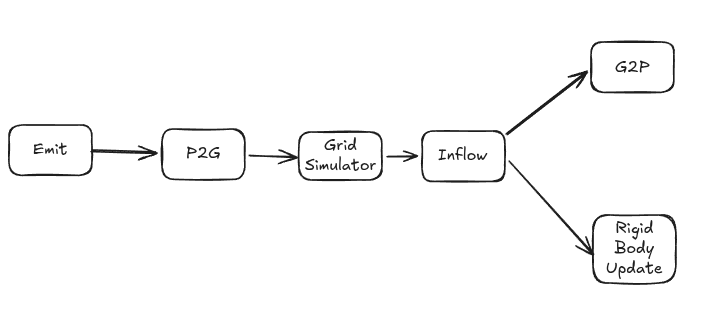

# fluids

Fluids (and elastic) simulation with SPH and MPM

Currently supports both SPH and MLS-MPM backends for the simulations (see sources below). Only MLS-MPM supports elastic materials for now.

# Demos

## MPM
You can go ahead and create custom environments (see `environments.rs`) or custom objects (few examples in `primitives.rs`).
I have created a few example environments ("environments" are just alternative words for animations):
1. Drop blocks of various densities into the fluid (the densest block should sink):
```rs
use fluids::FluidCube;
use fluids::{Mpm, MultiBoxWaterCube, PumpAtCube, Scene, Sph};
fn main() {
    let mut scene = Scene::<Mpm>::new();
    scene.environment(MultiBoxWaterCube::default());
    scene.run().unwrap();
}
```


2. Pump water at a light rigid block:
```rs
use fluids::FluidCube;
use fluids::{Mpm, MultiBoxWaterCube, PumpAtCube, Scene, Sph};
fn main() {
    let mut scene = Scene::<Mpm>::new();
    scene.environment(PumpAtCube::default());
    scene.run().unwrap();
}
```


## SPH
SPH has fewer features than MPM for now (fluid-solid interactions are not implemented in SPH). For now the only thing we can do
is spawn a block of water:
```rs
use fluids::FluidCube;
use fluids::{Mpm, MultiBoxWaterCube, PumpAtCube, Scene, Sph};
fn main() {
    let mut scene = Scene::<Sph>::new();
    let fluid = FluidCube::new(30, 0.03, [-0.95, 0.50, -0.7]);
    scene.add(fluid);
    scene.run().unwrap();
}
```


# Useful readings

These were some useful readings for my implementation:
## Physics

### MPM:
1. MPM Introduction: https://alexey.stomakhin.com/research/siggraph2016_mpm.pdf
2. MLS-MPM: https://yuanming.taichi.graphics/publication/2018-mlsmpm/mls-mpm-cpic.pdf
3. This article helped with debugging: https://nialltl.neocities.org/articles/mpm_guide

### SPH:
1. SPH: https://arxiv.org/pdf/2009.06944
2. Spatial hashing implementation on GPU:
    - 2a. Spatial hashing overview: https://haug.codes/blog/locally-perfect-hashing/
    - 2b. Radix sort on GPU: https://shi-yan.github.io/webgpuunleashed/Compute/radix_sort.html

## Graphics
Lots of wgpu graphics boilerplate (e.g vertex / index / uniform buffers, depth buffer, `App`, `State` etc.) taken from https://sotrh.github.io/learn-wgpu/

1. Marching Cubes: https://www.willusher.io/graphics/2024/04/22/webgpu-marching-cubes/
2. Screen space fluid rendering: https://www.researchgate.net/publication/220792184_Screen_space_fluid_rendering_with_curvature_flow

# Implementation

## MPM
Here is an overview of the series of shaders that MPM performs (see `MPMFluidSim` in mpm.rs):


P2G, Grid Simulator, and G2P are standard in MPM. Here are the additional bits:
1. Emit: to implement a pipe pumping water, we need to store the particles somewhere (not all particles fit the pipe). These are stored off-world. Emit brings the off-world particles into the pipe
2. Inflow: updates momentum of grid nodes inside the pipe to contain the momentum based on the passed in `flow` parameter

## SPH
SPH shader dag is simpler:
```
Spatial hash -> compute particle fluid density -> compute forces and perform particle advection
```